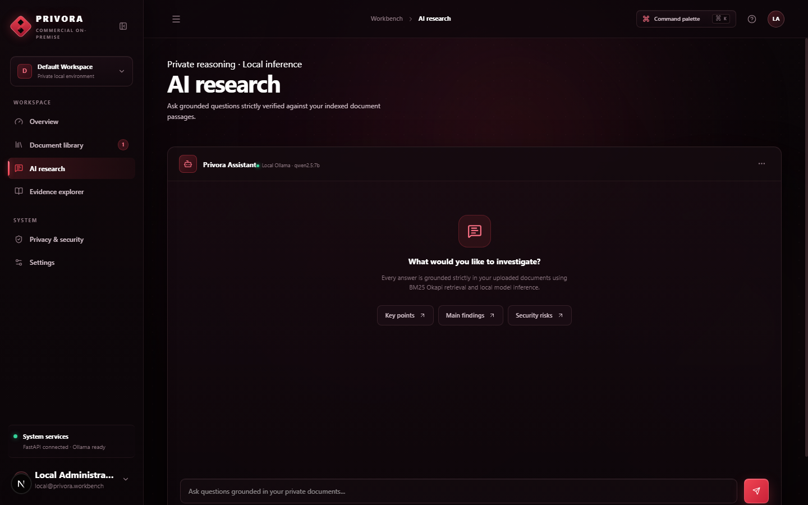
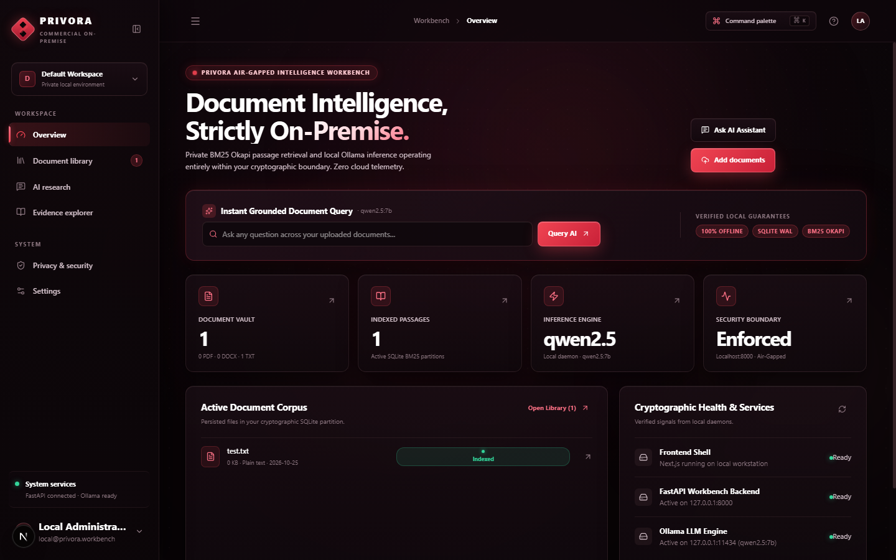
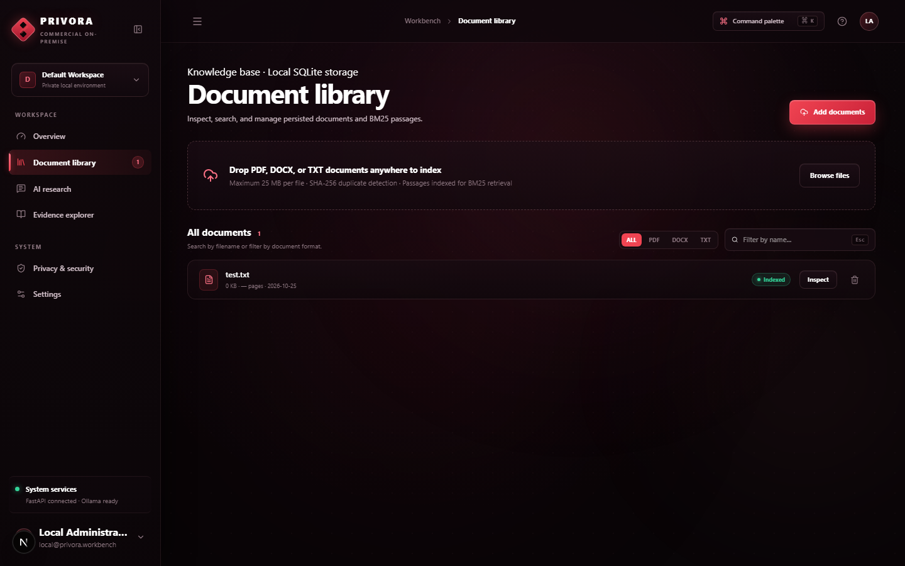
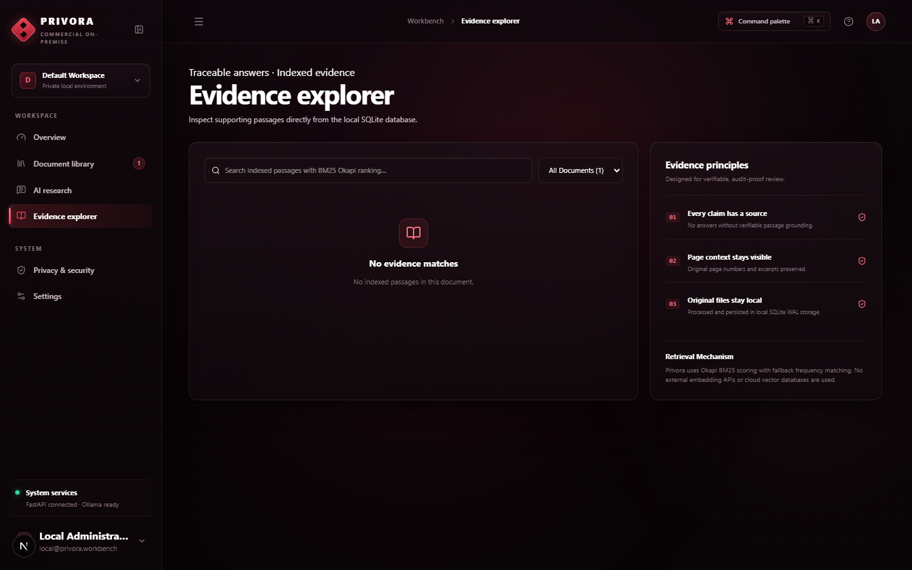
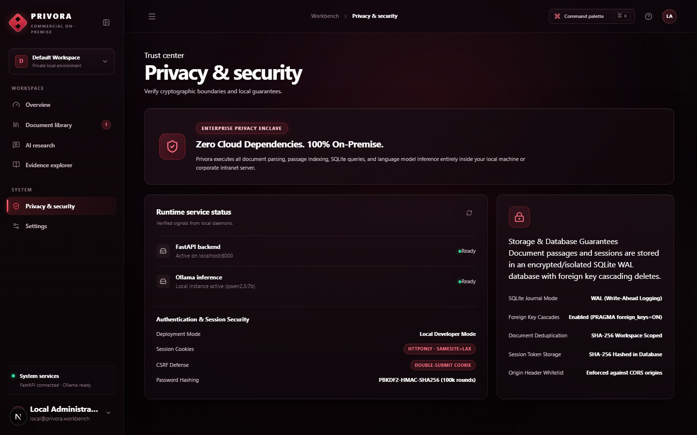
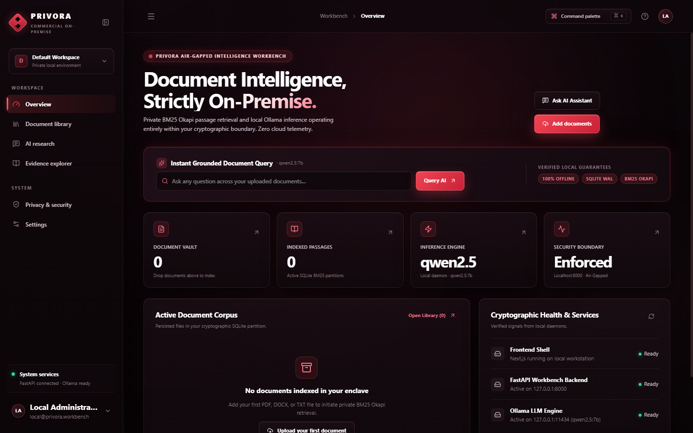
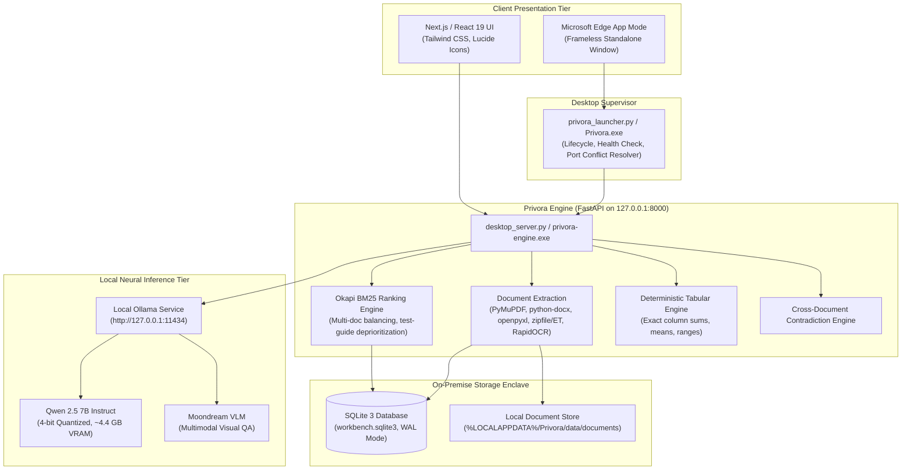

<div align="center">

# PRIVORA
### Private Document Intelligence Workbench for Confidential Data

**Private On-Premise Document Intelligence & Tabular Analytics**  
**Air-Gapped Desktop & Enterprise Edition**

[](LICENSE)
[](https://www.python.org/)
[](https://nextjs.org/)
[](https://fastapi.tiangolo.com/)
[](https://ollama.com/)
[](backend/tests/)

*A zero-trust, enterprise-grade on-premise document intelligence platform engineered for confidential refinery manuals, legal agreements, engineering schematics, and operational logs without transmitting a single byte to external clouds.*

---

</div>

## 📌 Problem Statement & Mission

In high-consequence industries such as petrochemical refining, national defense, and confidential manufacturing, operational documentation contains trade secrets, piping and instrumentation diagrams (P&IDs), process parameters, and critical safety thresholds. Public cloud AI platforms (ChatGPT, Claude, Gemini) risk data leakage and violate data residency mandates.

**Privora Mission**: Develop an on-premise, air-gapped document intelligence workbench capable of indexing confidential industrial documents, answering complex cross-document technical queries with verified citations, performing deterministic spreadsheet analytics, and auditing conflicting records—running **100% locally on workstation hardware**.

---

## 📸 Interface Preview

<div align="center">

| AI Research & Citation Grounding | Multimodal Page Preview & Visual QA |
| :---: | :---: |
|  |  |

| Multi-Format Document Library | Evidence Explorer & Passage Inspection |
| :---: | :---: |
|  |  |

| Privacy & Security Enclave Audit | Unified Architecture on Port 8000 |
| :---: | :---: |
|  |  |

</div>

---

## ✨ Core Features & Differentiation

1. **Zero Cloud Exfiltration**:
   - Complete document parsing, passage indexing, Okapi BM25 ranking, and neural synthesis run strictly on `127.0.0.1`.
   - Zero telemetry, zero external tracking, zero cloud API dependencies.

2. **6-Format Native Document Intelligence**:
   - **PDF**: Page-by-page text extraction, coordinate tracking, and PyMuPDF 150 DPI page rendering.
   - **DOCX**: Heading hierarchy (`Heading 1-6`), table rows, and de-duplicated cell extraction.
   - **ODT (OpenDocument Text)**: Native standard library XML parsing of headings, paragraphs, and formatted tables with zero external packages.
   - **XLSX**: Multi-sheet numerical data parsing with exact coordinate ranges (`Sheet1!A1:D100`).
   - **CSV**: Automatic delimiter sniffing (`,`, `;`, `\t`, `|`) and tabular coordinate extraction.
   - **TXT / Markdown / Images**: Unicode-normalized text, OCR coordinate extraction via RapidOCR ONNX.

3. **Source-Grounded Neural Synthesis (Qwen 2.5 7B)**:
   - Primary LLM: **Qwen 2.5 7B Instruct** running via local Ollama.
   - Strict hallucination guardrails: every factual claim is cited with clickable pills (`[1]`, `[2]`).
   - Explicit refusal discipline: unsupported questions strictly return `support_level: unsupported` with zero fabrications.
   - Mathematical derivations derived from source numbers are calculated and classified as fully supported.

4. **Visual Question Answering & Diagram Inspection (Moondream VLM)**:
   - Slide-over detail drawer with independent vertical scrolling and zero content clipping.
   - Inspect engineering diagrams, piping schematics, and charts with local Moondream VLM.

5. **Deterministic Spreadsheet Analytics**:
   - Dedicated numerical calculation engine (`app/tabular_analytics.py`) that computes exact sums, means, min/max, and record counts directly from raw cell data. Eliminates LLM math errors.

6. **Cross-Document Contradiction Auditing**:
   - Automated detection of conflicting numbers, dates, payment terms, or operating limits between distinct documents with dual-source citations.
   - Test-guide de-prioritization: ensures operational source documents take precedence over testing sheets.

7. **Multi-Tenant Workspaces & RBAC**:
   - Role-Based Access Control (`owner`, `admin`, `member`, `viewer`) with isolated SQLite workspaces and tamper-evident audit logging.

8. **Empirical Benchmark Suite**:
   - Six built-in evaluation categories (Factual, Multi-Doc, Numerical, Comparison, Missing Info, Unsupported Query).
   - Proven baselines: **91.67% Answer Correctness**, **0.0% Suite Hallucination**, **100.0% Citation Groundedness**, **8.86 ms BM25 latency**.

---

## 🏛️ System Architecture



---

## 💻 Technology Stack

| Layer | Technologies | Purpose |
| :--- | :--- | :--- |
| **Frontend** | Next.js 16.4, React 19, TypeScript, Tailwind CSS | High-density dark workstation UI, evidence explorer, drawer panels |
| **Backend API** | FastAPI, Uvicorn, Pydantic v2 | High-throughput async REST endpoints, streaming responses |
| **Document Parsing** | PyMuPDF (fitz), python-docx, openpyxl, zipfile, xml.etree | PDF, DOCX, ODT, XLSX, CSV, and TXT parsing with zero cloud calls |
| **Optical Character Recognition** | RapidOCR ONNX Runtime, Pillow | Local ONNX-accelerated OCR for scanned drawings and images |
| **Information Retrieval** | Okapi BM25 (rank-bm25), Tokenizer | High-precision passage retrieval, page-aware boosting, test-guide filtering |
| **Storage & Persistence** | SQLite 3 (WAL mode) | Multi-tenant workspaces, indexed passage chunks, tamper-evident audit logs |
| **Local LLM Inference** | Ollama, Qwen 2.5 7B Instruct, Moondream VLM | 100% on-premise neural answer synthesis, diagram reasoning |
| **Desktop Packaging** | PyInstaller, Inno Setup 6 | Self-contained Windows executable bundle and standalone installer |

---

## 🚀 Quick Start Guide

### Option A: Windows Desktop Edition (Zero Setup)
1. Download `Privora-Setup-1.1.0.exe` from the latest [GitHub Release](https://github.com/privora/privora/releases).
2. Run the installer. It installs to `%LOCALAPPDATA%\Programs\Privora` without requiring Administrator privileges.
3. Launch **Privora** from the Desktop shortcut or Start Menu.
4. If Ollama is not installed, the setup wizard will provide a one-click prompt to download it from [ollama.com](https://ollama.com).

---

### Option B: Run From Source (Development / Linux / Mac / Windows)

#### 1. Prerequisites
- **Python**: 3.10, 3.11, 3.12, 3.13, or 3.14
- **Node.js**: 18.x or 20.x+
- **Ollama**: [ollama.com](https://ollama.com)

#### 2. Local Ollama Setup
Install Ollama and pull the required open-weights models:
```bash
# Pull primary reasoning model (Qwen 2.5 7B)
ollama pull qwen2.5:7b

# (Optional) Pull vision model for Visual QA
ollama pull moondream

# Verify Ollama is running
curl http://127.0.0.1:11434/api/tags
```

#### 3. Clone & Install Dependencies
```bash
git clone https://github.com/your-username/privora.git
cd privora

# Backend setup
python -m venv .venv

# On Windows:
.venv\Scripts\activate
# On Linux / macOS:
source .venv/bin/activate

pip install -r requirements.txt

# Frontend setup
npm install
```

#### 4. Run the Application
You can run the backend and frontend separately for development:

**Terminal 1 — Backend:**
```bash
cd backend
python desktop_server.py
# Backend API runs at http://127.0.0.1:8000
# OpenAPI Docs available at http://127.0.0.1:8000/docs
```

**Terminal 2 — Frontend:**
```bash
npm run dev
# Frontend runs at http://localhost:3000
```

Or run the unified desktop launcher on Windows:
```powershell
.\start-desktop.ps1
```

---

## 📊 Supported Document Formats

| Format | Extension | Extraction Capabilities | Coordinate Metadata |
| :--- | :---: | :--- | :--- |
| **Portable Document Format** | `.pdf` | Digital text, table structures, 150 DPI page previews, ONNX OCR | Page numbers, bounding boxes |
| **Microsoft Word** | `.docx` | Heading hierarchy (`Heading 1-6`), paragraphs, body tables | Section titles, table indices |
| **OpenDocument Text** | `.odt` | Native XML headings (`text:h`), paragraphs (`text:p`), tables | Section titles, table names |
| **Microsoft Excel** | `.xlsx` | Multi-sheet rows, deterministic column math (sum/mean/min/max) | Sheet name, cell coordinates (`A1:D50`) |
| **Comma-Separated Values** | `.csv` | Auto-delimiter sniffing (`,`, `;`, `\t`), column metrics | Row ranges, column names |
| **Plain Text / Markdown** | `.txt`, `.md` | Unicode normalization, paragraph chunking | Section titles, chunk IDs |
| **Images (Drawings / Schematics)**| `.png`, `.jpg`, `.jpeg` | RapidOCR text recognition, Moondream multimodal visual QA | OCR text blocks, VLM visual grounding |

---

## 🧪 Automated Testing & Verification

Privora includes an exhaustive automated test suite with **121 tests** across 17 modules:

```bash
# Set PYTHONPATH to the backend directory
# Windows PowerShell:
$env:PYTHONPATH = "$PWD\backend"
python -m pytest backend/tests -v

# Linux / macOS:
PYTHONPATH=backend python -m pytest backend/tests -v
```

### Static Type Checking & Production Build
```bash
# TypeScript compiler check (0 errors required)
npx tsc --noEmit

# Static Next.js export build
npm run build
```

---

## 📓 Google Colab Notebook

To experiment with Privora's backend extraction, BM25 retrieval, and API endpoints without installing anything locally, open our Colab demonstration notebook:

[](notebooks/Privora_Colab_Demo.ipynb)

*Note: The Colab notebook runs the headless Linux Python engine, document parser, BM25 search, and REST API. The Windows desktop launcher and Edge App Mode are specific to Windows workstations.*

---

## ⚠️ Hardware Sizing & Limitations

1. **Hardware Sizing**:
   - **Recommended**: NVIDIA GPU with $\ge 8\text{ GB}$ VRAM (e.g. RTX 3060 / 4060) + 16 GB System RAM.
   - **CPU-Only Fallback**: Can run on modern 8-core CPUs (AMD Ryzen 7 / Intel Core i7) with 16 GB RAM using smaller models like `qwen2.5:3b` or `qwen2.5:1.5b`.
2. **Local Model Dependency**:
   - Neural synthesis requires local Ollama to be running. If Ollama is stopped, Privora operates in **Offline Evidence Mode**—document ingestion, BM25 search, passage inspection, and tabular math remain 100% operational.
3. **Air-Gap Scope**:
   - Privora enforces zero network transmission at the application layer. For formal military or refinery air-gap compliance, physical network disconnection or host firewall rules should be maintained.

---

## 📜 License

Privora is licensed under the **Apache License, Version 2.0**. See the [LICENSE](LICENSE) file for details.

---

<div align="center">
<strong>Privora — Private Document Intelligence Workbench</strong>
</div>
